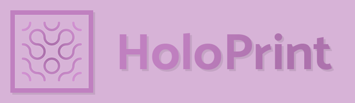

### Über
HoloPrint ist eine Web-App die MCBE Strukturdateien in Ressourcenpakete, die Hologramme von Bauwerken anzeigen, umwandelt. Es baut auf der Arbeit von [Structura](https://github.com/RavinMaddHatter/Structura) auf, ein ähnliches Projekt. Sowohl Structura als auch HoloPrint verfolgen das Ziel die Nutzung von Java Edition Mods wie [Litematica](https://github.com/maruohon/litematica) und [Schematica](https://github.com/Lunatrius/Schematica) für Bedrock Edition Nutzer durch Ressourcenpakete nachzubilden.

> [!TIP]
> Schau dir das [Wiki](https://holoprint-mc.github.io/wiki) an für ausführlichere Anleitungen!

### Nutzung
> [!NOTE]
> Auf Android ist der Exportknopf des Konstruktionsblocks versteckt; bitte nutze [dieses Ressourcenpaket](https://holoprint-mc.github.io/exportbutton) um sie wieder einzublenden“.
1. Nutze einen Konstruktionsblock um eine `.mcstructure` Datei zu exportieren. Führe den Befehl `/give @s structure_block` aus um einen Konstruktionsblock zu erhalten.  
  
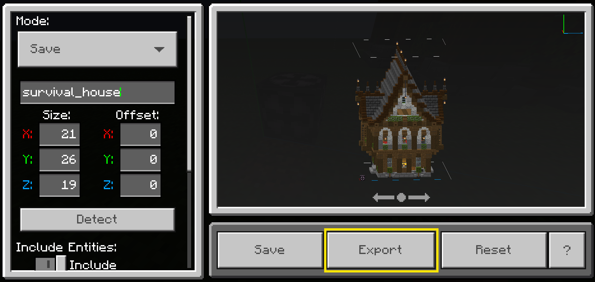
2. Gehe zu [https://holoprint-mc.github.io](https://holoprint-mc.github.io), wähle deine `.mcstructure` Datei aus, und passe die Einstellungen nach deinen Wünschen an.  
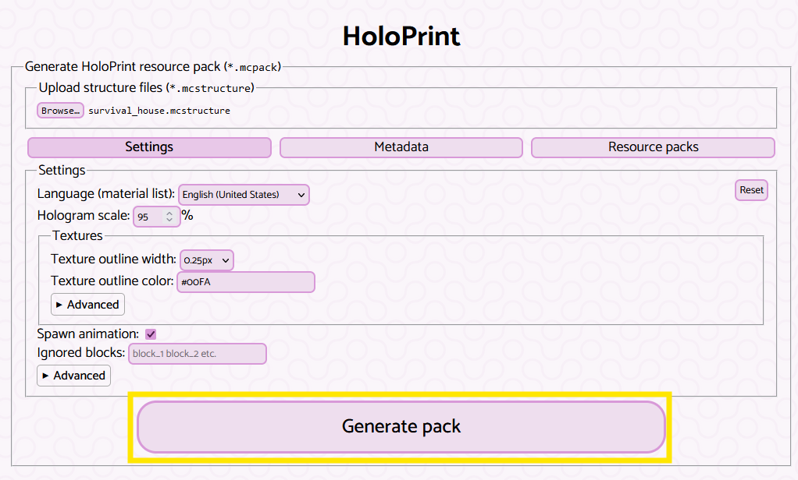
3. Generiere und lade dein Ressourcenpaket (`.mcpack`) herunter.  
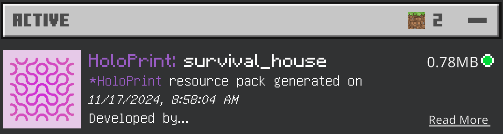
4. Aktiviere dein Ressourcenpaket und platziere einen Rüstungsständer in deiner Welt.  
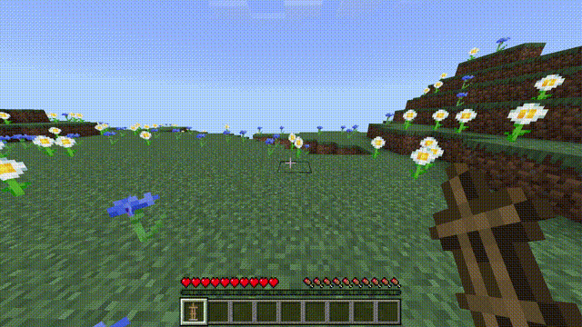

### Hologrammsteuerung ([Wiki](https://holoprint-mc.github.io/wiki/hologram-controls))
- Rendern ein-/ausschalten: Ziegel  
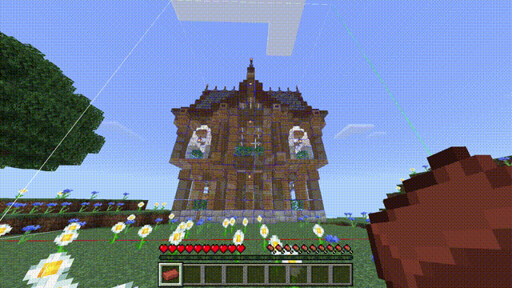
- Transparenz ändern: Amethystscherbe (schleiche um zu senken, stehe um zu erhöhen)  
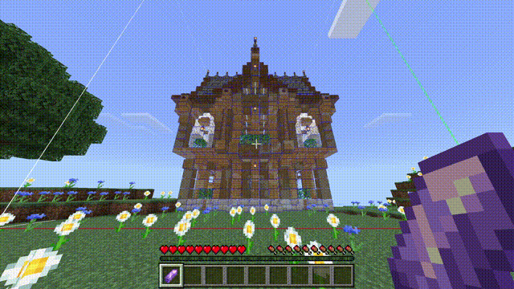
- Schicht ändern: Leder (schleiche um zu senken, stehe um zu erhöhen), oder ändere die Pose des Rüstungsständers  
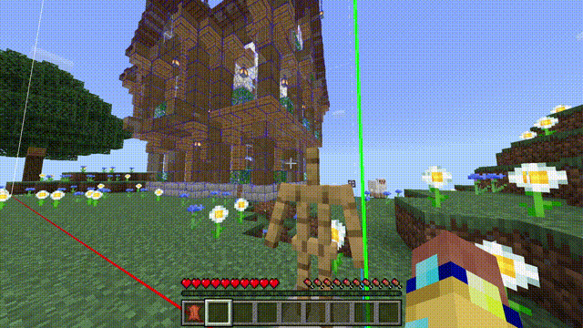
- Hologramm bewegen: Stock  

- Hologramm rotieren: Kupferbarren  
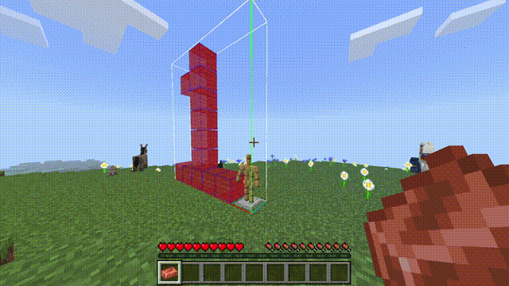
- Block Überprüfung: Eisenbarren  

- Materialliste: Tablaturtaste (Tastatur), Buchsymbol (Berührung)  
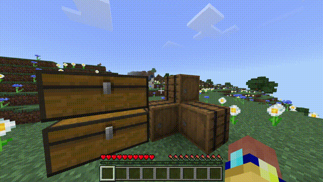
- Farbton-Überlagerung ein-/ausschalten: Weißer Farbstoff  
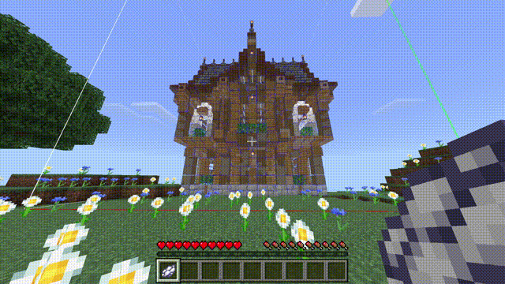
- Schichtmodus ändern: Feuerstein  
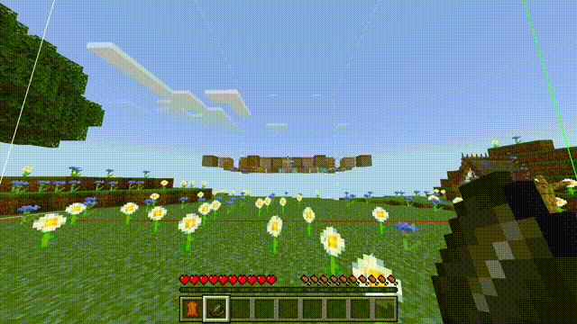
- Struktur ändern: Pfeil, oder schlage einen Rüstungsständer, der nichts hält  
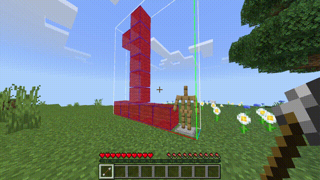
- Hologrammeinstellungen speichern: Papier  
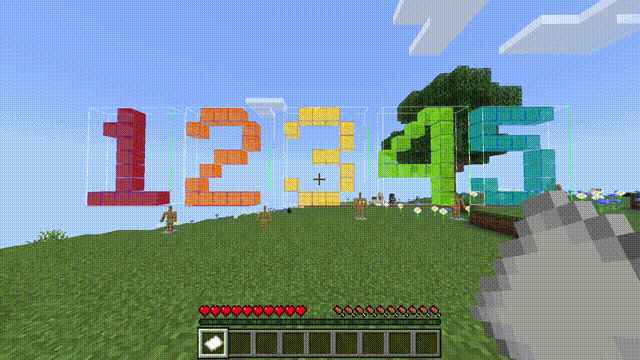
- Rüstungsständersteuerung: Gebe Item oder schlage  
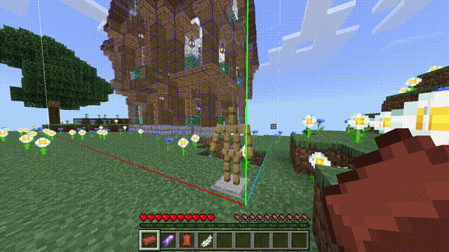
- Spielersteuerung deaktivieren: Knochen  
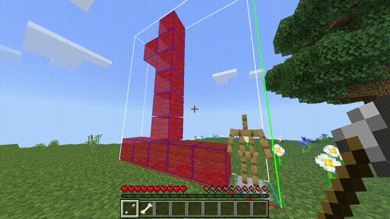
> [!WARNING]
> Die Spielersteuerung wird vielleicht unzuverlässig sein, aber die Rüstungsständersteuerung wird immer funktionieren.

Besonderen Dank an **kizoku246** für das Haus in diesen Bildern!

---

### Danksagungen
- [Structura](https://github.com/RavinMaddHatter/Structura): Inspiration, Grundlage für dieses Projekt. Ohne die Arbeit von [RavinMaddHatter](https://github.com/RavinMaddHatter) und [weitere](https://github.com/RavinMaddHatter/Structura/graphs/contributors), hätte dieses Projekt mehrere Stunden mehr gedauert.
- [Tab Key Playerlist UI](https://github.com/YuuhaLand/Tabkey_Playerlist_UI) von [YuuhaLand](https://github.com/YuuhaLand): Grundlage für die Materialliste-UI
- [Nextr](https://mcpedl.com/user/nextr): Steuerung der Item-Texturen (modifiziert)
- [Indyfficient](https://www.youtube.com/@Indyfficient): Die Idee die Struktur durch schlagen des Rüstungsständers zu verändern
- [Prowl8413](https://www.youtube.com/@Prowl8413): Grundsätzlichen Feedback während der Entwicklung
- [KITTUradiates](https://github.com/KITTUradiates): Feedback und Vorschläge
- [ESBE 3G](https://github.com/McbeEringi/esbe-3g) von [McbeEringi](https://github.com/McbeEringi): Technische Basis für die Infoanzeige-UI
- [Rainbow-Editor](https://github.com/PurpleRain-PR/Rainbow-Editor) von [PurpleRain-PR](https://github.com/PurpleRain-PR): Die Idee ein GLB von der Vorschau zu exportieren
- Dokumentation:
  - [Bedrock Wiki](https://wiki.bedrock.dev): Beste Ressource für das Lernen über Ressourcen-/Verhaltenspakete!
  - [Minecraft Wiki](https://minecraft.wiki): Block Entity Liste, Block Zustände und Datenwerte, und so viel mehr!
  - [Bedrock `.mcstructure`. Dateien](https://gist.github.com/tryashtar/87ad9654305e5df686acab05cc4b6205): Erklärung von der NBT Struktur von Struktur Dateien, von [tryashtar](https://github.com/tryashtar)
  - [Bugrock JSON UI Schemas](https://github.com/KalmeMarq/Bugrock-JSON-UI-Schemas) von [KalmeMarq](https://github.com/KalmeMarq): Um mich, als ich mit UI gearbeitet habe geistig gesund zu halten; aktueller als das Wiki
  - [Magic Method Docs](https://github.com/BedrockPlus/MagicMethodDocs): Dokumentation von [Chainsketch](https://www.youtube.com/@Chainsketch)'s technische Daten zwischen Entities in Ressourcenpaketen zu verschicken, geschrieben von [White](https://github.com/WhiteOnGitHub) und [chyves](https://github.com/notchyves)
  - [Microsoft BE Referenz Dokumentationen](https://learn.microsoft.com/en-us/minecraft/creator/reference): Offizielle Schemas für Addons/Ressourcenpakete 
- JavaScript Bibliotheken:
  - [NBTify](https://github.com/Offroaders123/NBTify): Minecraft NBT Leser
  - [tga.js](https://github.com/vthibault/tga.js): TGA zu PNG Bild Umwandlung
  - [potpack](https://github.com/mapbox/potpack): Texturatlas Verpackung
  - [JSZip](https://github.com/Stuk/jszip): Pack zippen
  - [Minecraft Creator Tools](https://github.com/Mojang/minecraft-creator-tools): LevelDB Leser
  - [three.js](https://github.com/mrdoob/three.js): Zum Rendern der Vorschau
  - [stats.js](https://github.com/mrdoob/stats.js) und [lil-gui](https://github.com/georgealways/lil-gui): Vorschau widgets
  - [Supabase](https://supabase.com): Kostenlose Datenbank für das Aufnehmen von erstellten Packs
  - [strip-json-comments](https://github.com/sindresorhus/strip-json-comments): Entfernt Kommentare von JSON Dateien
  - [deepmerge](https://github.com/TehShrike/deepmerge): Verschmelzen von JSON Dateien
